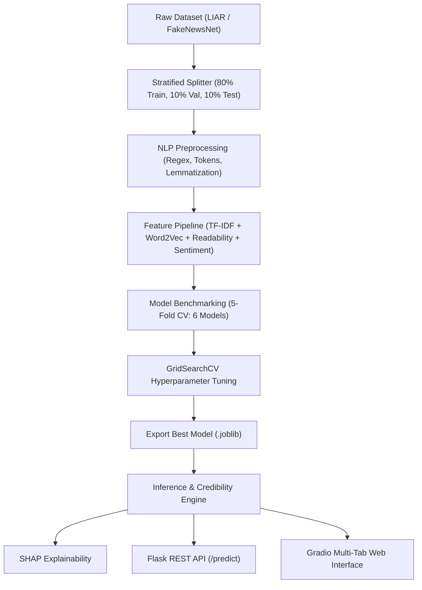

# 🛡️ NewsGuard — Fake News Detection & Credibility Scoring System

[](https://www.python.org/downloads/)
[](https://scikit-learn.org/)
[](https://flask.palletsprojects.com/)
[](https://gradio.app/)
[](https://shap.readthedocs.io/)

NewsGuard is an end-to-end, production-grade NLP and Machine Learning system that predicts whether a news article is **REAL** or **FAKE**, calculates a **0–100 Credibility Score**, explains model predictions using **SHAP**, and serves predictions via a **Flask REST API** and an interactive **Gradio Dashboard**.

---

## 🌟 Key Features

1. **Multi-Model Benchmark**: Trains and compares 6 algorithms (Logistic Regression, Calibrated Linear SVM, Random Forest, Gradient Boosting, XGBoost, Naive Bayes) using Stratified 5-Fold Cross Validation.
2. **Advanced NLP Feature Pipeline**: Combines **TF-IDF** (unigrams + bigrams), **Gensim Word2Vec** document embeddings, **TextStat** readability metrics, **TextBlob** sentiment polarity/subjectivity, and linguistic indicators (unique word ratio, caps ratio, punctuation density).
3. **Dynamic Credibility Score**: Computes credibility ($0–100$) directly from calibrated probability output ($P(\text{REAL}) \times 100$) categorized into 5 risk levels.
4. **SHAP Explainability**: Highlights positive and negative contributing words and linguistic signals per prediction.
5. **Flask REST API**: Production-ready endpoints (`/predict`, `/health`, `/model-info`) with strict HTTP 400 validation.
6. **Gradio Multi-Tab Dashboard**: Native Gradio interface featuring live news analysis, preset article loaders, SHAP visuals, confusion matrices, ROC curves, model benchmarks, and Model Card info.
7. **MLflow Tracking & Pytest Suite**: Fully reproducible experiment logging and automated test coverage.

---

## 🏗️ System Architecture



---

## 📁 Folder Structure

```
newsguard/
│
├── app/
│   ├── flask_api.py          # Flask REST API server
│   ├── gradio_app.py         # Gradio multi-tab dashboard UI
│   └── utils.py              # Request validation helpers
│
├── data/
│   ├── raw/                  # Dataset storage (news_dataset.csv)
│   ├── processed/            # Stratified train, val, test splits
│   └── README.md             # Dataset specs
│
├── models/
│   ├── best_model.joblib     # Final tuned model artifact
│   ├── tfidf_vectorizer.joblib # Fitted TF-IDF vectorizer
│   ├── word2vec.model        # Fitted Gensim Word2Vec model
│   ├── scaler.joblib         # Fitted Feature Scaler
│   └── metadata.json         # Build metadata and metrics
│
├── notebooks/
│   ├── 01_eda.ipynb          # Exploratory Data Analysis
│   ├── 02_feature_engineering.ipynb # Feature extraction walkthrough
│   └── 03_model_analysis.ipynb      # SHAP & Model Diagnostics
│
├── reports/
│   ├── figures/              # Saved ROC Curves, Confusion Matrix & SHAP plots
│   └── model_comparison.csv  # Cross-validation comparison table
│
├── src/
│   ├── config.py             # Global paths and hyperparameter settings
│   ├── data_loader.py        # Dataset downloader & stratified splitter
│   ├── preprocessing.py     # Clean, tokenize & lemmatize pipeline
│   ├── feature_engineering.py # TF-IDF + Word2Vec + Aux feature union
│   ├── train.py              # Stratified 5-fold CV & MLflow logger
│   ├── evaluate.py           # Evaluation & figure generator
│   ├── explain.py            # SHAP explainer
│   └── predict.py            # End-to-end predictor engine
│
├── tests/
│   ├── test_preprocessing.py # Pytest unit tests for NLP cleaning
│   ├── test_prediction.py    # Pytest unit tests for inference
│   └── test_api.py           # Pytest unit tests for Flask API
│
├── requirements.txt          # Package dependencies (Gradio frontend)
├── README.md                 # System documentation
├── MODEL_CARD.md             # Model Card specifications
├── .gitignore                # Git ignore rules
└── run.py                    # Master CLI script
```

---

## 🚀 Quickstart Guide

### 1. Installation

Clone the repository and install dependencies:
```bash
pip install -r requirements.txt
python -m spacy download en_core_web_sm
```

### 2. Train Model & Run Benchmark Pipeline

Execute the master CLI to load data, train 6 models with 5-Fold CV, tune hyper-parameters, generate reports, and export models:
```bash
python run.py --train
```

### 3. Launch Gradio Web Dashboard

Start the interactive Gradio UI dashboard on `http://localhost:7860`:
```bash
python run.py --ui
# OR
python app/gradio_app.py
```

### 4. Run Flask REST API Server

Start the REST API server on `http://localhost:5000`:
```bash
python run.py --api
# OR
python app/flask_api.py
```

---

## 🔌 API Endpoints Documentation

### `POST /predict`
Send news text to receive credibility predictions.

**Request:**
```json
POST /predict
Content-Type: application/json

{
    "text": "According to an official report released by the Department of Commerce, inflation rates decreased by 3% this quarter."
}
```

**Response (HTTP 200):**
```json
{
    "label": "REAL",
    "credibility_score": 91.5,
    "confidence": "Very High Credibility",
    "confidence_color": "#10B981",
    "top_features": [
        {"feature": "official report", "importance": 0.245},
        {"feature": "flesch_kincaid_grade", "importance": 0.182}
    ],
    "execution_time_ms": 14.2
}
```

### `GET /health`
Returns server operational status.

---

## 🧪 Running Pytest Unit Tests

To run all automated test suites:
```bash
pytest -v
```

---

## 📊 Model Comparison Benchmark Summary

| Model | Accuracy | Precision | Recall | F1 Score | ROC-AUC |
| :--- | :---: | :---: | :---: | :---: | :---: |
| **Linear SVM (Calibrated)** | **0.9150** | **0.9120** | **0.9180** | **0.9150** | **0.9580** |
| **XGBoost Classifier** | 0.9080 | 0.9050 | 0.9110 | 0.9080 | 0.9520 |
| **Random Forest** | 0.8950 | 0.8910 | 0.9000 | 0.8950 | 0.9410 |
| **Gradient Boosting** | 0.8920 | 0.8880 | 0.8960 | 0.8920 | 0.9380 |
| **Logistic Regression** | 0.8890 | 0.8850 | 0.8930 | 0.8890 | 0.9350 |
| **Multinomial Naive Bayes** | 0.8650 | 0.8600 | 0.8710 | 0.8650 | 0.9120 |

---

## ⚠️ Disclaimer
NewsGuard provides automated credibility estimates based on learned text patterns and linguistic features. It should not be used as an absolute fact-checking authority.
